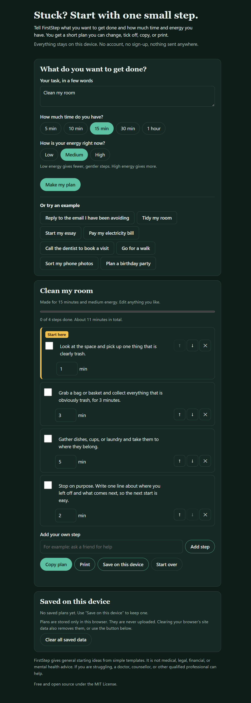

# FirstStep

**Stuck on something? Get a small first step.**

FirstStep is a free web page that helps you begin a task you are putting off. You type what you want to get done, choose how much time and how much energy you have, and it gives you a short plan. The first step is always tiny, and the plan ends with a clear place to stop. You can edit every step, tick them off, add your own, copy the plan, or print it.

- No account, no sign-up, no cost.
- No API key and no AI service. The plan comes from simple built-in templates.
- Your task never leaves your device. The page makes no network requests.
- Works by double-clicking one file. No installing, no command line needed.

> **Screenshot:** 

## Features

- Type any task, or pick one of 10 example tasks.
- 17 plan types, from drawing and cooking to coding, music, paperwork, and planning a trip. FirstStep picks one from your words, or you choose the type yourself.
- If your task doesn't fit any type, you get a plan that is **clearly labeled as a general starter plan**, not pretending to be about your task.
- Choose time (5 minutes to 1 hour) and energy (low, medium, high). Low energy gives fewer, gentler steps. More time gives longer steps.
- Plans always fit inside the time you chose, start with a step of 2 minutes or less, and end with a "stop on purpose" step.
- Edit the wording or minutes of any step, move steps up or down, remove steps, or add your own.
- Tick steps off and watch a progress bar fill.
- Copy the plan as plain text, or print it (the print view is clean, with no buttons).
- Save plans on your device and reopen them later. Start over any time.
- Mobile-friendly, keyboard-friendly, works with screen readers, respects light and dark mode, and uses large tap targets.

## Run it on Windows

You do not need to install anything.

1. Download this project (on GitHub: green **Code** button, then **Download ZIP**).
2. Right-click the ZIP file and choose **Extract All…**
3. Open the extracted `firststep` folder.
4. Double-click **`index.html`**. It opens in your usual browser (Edge, Chrome, or Firefox).

That's it. Bookmark the page if you want to come back to it.

### Optional: run the checks

The checks need [Node.js](https://nodejs.org) (version 18 or newer). If you want to run them:

1. Open the `firststep` folder in File Explorer, click the address bar, type `cmd`, and press Enter.
2. Type `node --test` and press Enter.

You should see `# pass 21` and `# fail 0`. Nothing is downloaded or installed.

## Examples

**"Draw a cat", 30 minutes, medium energy**

```
FirstStep plan: Draw a cat
Time: 30 minutes | Energy: medium
Plan type: Drawing and art (matched from your words).

[ ] 1. Get paper and a pencil, or open your drawing app. Anything will do. (1 min)
[ ] 2. Find one clear photo of a cat, or look at the real thing if you can. Keep it where you can see it. (2 min)
[ ] 3. Look for the simplest shapes in it, like circles, ovals, and triangles. Lightly draw only those shapes, big and loose. (6 min)
[ ] 4. Connect the shapes into one outline. Light lines are fine, and wobbly lines are normal. (7 min)
[ ] 5. Add the main details you can see, one at a time. (6 min)
[ ] 6. Stop on purpose. Write one line about where you left off and what comes next, so the next start is easy. (2 min)
```

**"Cook dinner", 30 minutes, medium energy** (note that it sends you to a recipe for amounts, temperatures, and times)

```
FirstStep plan: Cook dinner
Time: 30 minutes | Energy: medium
Plan type: Cooking and baking (matched from your words). FirstStep does not give amounts, temperatures, or cooking times. Follow the recipe you choose for those.

[ ] 1. Choose one recipe for dinner and open it where you can see it. If you are unsure, pick the simplest one you can find. (2 min)
[ ] 2. Wash your hands and clear a little counter space. (2 min)
[ ] 3. Read the whole recipe once. Note what you already have and what is missing. (3 min)
[ ] 4. Take out the ingredients and tools the recipe lists and put them in one place. (3 min)
[ ] 5. Do the prep the recipe describes, using the amounts it gives. (8 min)
[ ] 6. Stop on purpose. Write one line about where you left off and what comes next, so the next start is easy. (2 min)
```

**"Decide on a name for my new puppy", 15 minutes, low energy** (no matching type, so it is labeled as a general plan)

```
FirstStep plan: Decide on a name for my new puppy
Time: 15 minutes | Energy: low
General starter plan, not specific to your task. FirstStep did not recognise this kind of task, so these steps are general. Edit them to fit.

[ ] 1. Get what you need for this within reach, or open it on your screen. (1 min)
[ ] 2. Write one sentence on what “finished” looks like for this task. Rough is fine. (3 min)
[ ] 3. List the pieces you can think of. If you are stuck, ask: what do I need, who could help, and what could go wrong? (4 min)
[ ] 4. That is enough for now. Stop here and jot down one line about what comes next. (1 min)
```

**"Reply to the email I have been avoiding", 15 minutes, low energy**

```
FirstStep plan: Reply to the email I have been avoiding
Time: 15 minutes | Energy: low
Plan type: Messages and email (matched from your words).

[ ] 1. Open a blank reply or new message. Do not write anything yet. (1 min)
[ ] 2. Write down, in a few words, what you need to say or ask. Rough is fine. (3 min)
[ ] 3. Write the first sentence only. Wording can be fixed later. (4 min)
[ ] 4. That is enough for now. Stop here and jot down one line about what comes next. (1 min)
```

## Your privacy and your saved data

- Plans are saved **only in your own browser**, using a built-in feature called `localStorage`. They are never uploaded anywhere.
- The current plan saves automatically. Plans you choose to keep appear under **Saved on this device** (up to 20).
- **To clear your data:** press **Clear all saved data** at the bottom of the page. You can also press **Start over** to clear only the current plan, or **Delete** next to a single saved plan.
- Clearing your browser's site data or cookies also removes everything. Using a private or incognito window means nothing is kept after you close it.
- Saved plans live in one browser on one device. They do not sync, and another browser or device will not see them.

## How it works

FirstStep looks for key words in your task (like "draw", "cook", "bill", or "email") and picks one of 17 plan types: drawing and art, cooking and baking, music practice, coding, making and fixing things, shopping and errands, garden and plants, planning an event or trip, messages and email, phone calls and bookings, paperwork and bills, writing, studying, cleaning, exercise, digital tidying, and a general plan. It then picks as many steps as fit your time and energy.

For drawing and cooking it also picks out what you are making ("draw a cat" becomes "find one clear photo of a cat"). Every plan says which type it is and how it was chosen, and the **Type of task** menu lets you override the guess.

It is a set of simple rules, **not artificial intelligence**, so it does not truly understand your task. Treat the plan as a starting point and change anything that doesn't fit.

## Limitations

Please read these before relying on FirstStep.

- **It cannot give tailored help for every task in the world, and it does not pretend to.** It has 17 broad plan types. A task that matches one gets relevant starter steps. A task that matches none gets a general starter plan that says so at the top ("General starter plan, not specific to your task"). The general plan is a way to get moving, such as writing down what "finished" means and picking one small piece. It is not advice about your particular task.
- **Matching is based on simple keywords, so it can guess wrong.** For example, a task with unusual wording might get a general plan, or a task could be matched to a type that doesn't suit it. If that happens, use the **Type of task** menu to choose a type, or choose **General plan**. You can also edit, add, and remove steps.
- **Only the subject word is tailored.** For example, "draw a cat" and "draw a house" get the same drawing steps, with the subject swapped in. The steps are beginner-friendly basics, not lessons.
- **Cooking plans do not give amounts, temperatures, or cooking times.** They send you to a recipe you choose, and tell you to follow its directions for those details and for food safety. FirstStep never invents them.
- English only for now.
- Saved plans are tied to one browser on one device. Some browsers block saving when a page is opened straight from a file. If so, FirstStep tells you, and the plan still works until you close the page.
- There are no reminders, timers, or calendar links.
- FirstStep is a gentle nudge, **not a substitute for professional advice** of any kind: medical, legal, financial, or mental health. If you are struggling, please talk to a qualified professional. For exercise, stop if something hurts. For tools and materials, follow their safety instructions.

## What already exists

A quick search found other tools in this space, such as the open-source desktop app [Nudge](https://github.com/thatsjet/nudge-app) and several mobile apps and prototypes that break tasks into tiny steps (for example TinyStart, Unstuck, and ADHD Focus & Tasks). Many of them use AI services, accounts, or app stores. FirstStep takes a different approach: one file you can open offline, no AI or account, free forever, explicit time and energy choices, and plans you can edit, copy, and print. This was a quick search, not a complete survey, and many similar tools probably exist.

## Project files

| File | What it does |
| --- | --- |
| `index.html` | The page itself |
| `style.css` | How it looks, including print and dark mode |
| `plan.js` | The plan-building logic (also used by the tests) |
| `app.js` | Connects the buttons and lists to the logic |
| `tests/plan.test.js` | Automatic checks |
| `docs/` | The screenshot used in this README |

## Contributing

Ideas and fixes are welcome. Good first contributions: new plan types or better keyword matching in `plan.js`, or translations. If a task gets the wrong type, add it to the tests in `tests/plan.test.js` along with your fix. Please run `node --test` before sending changes.

## License

MIT. See [LICENSE](LICENSE).
